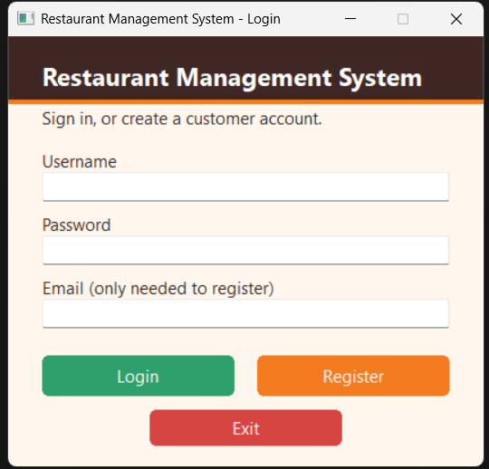
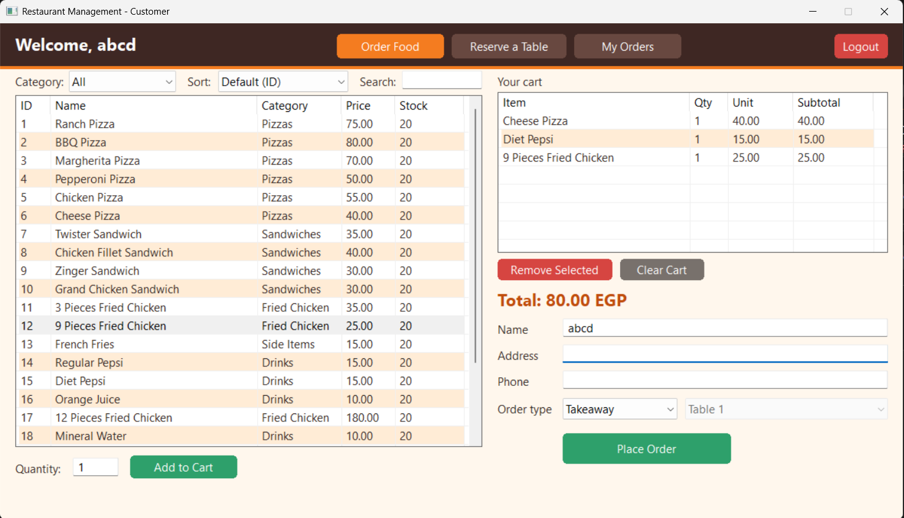
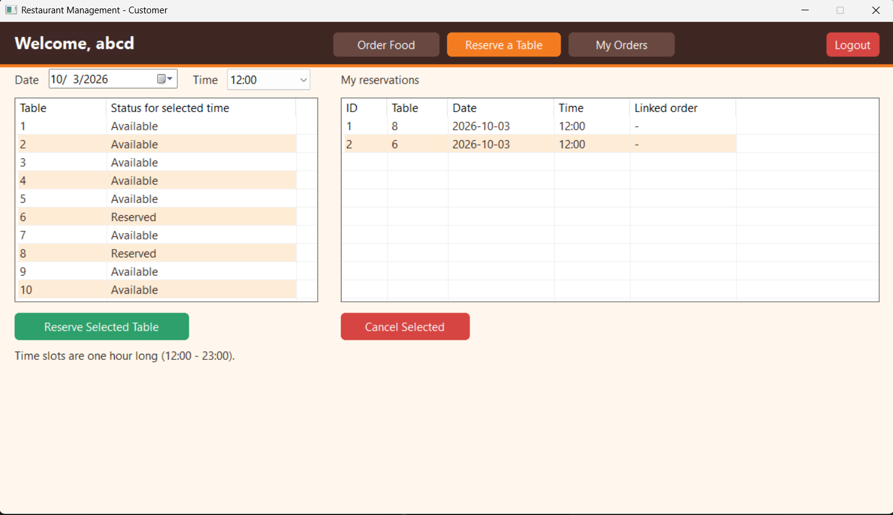
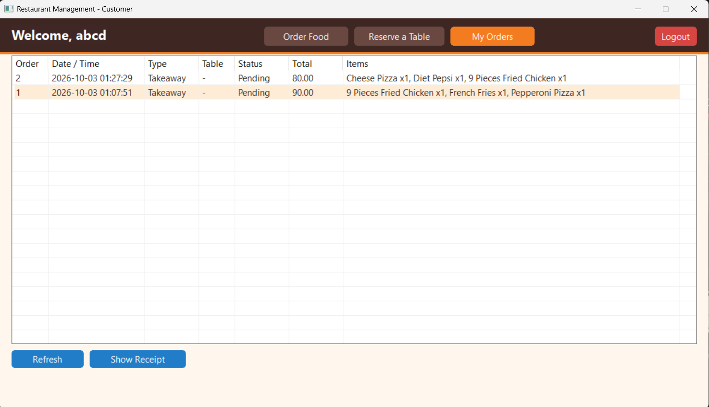
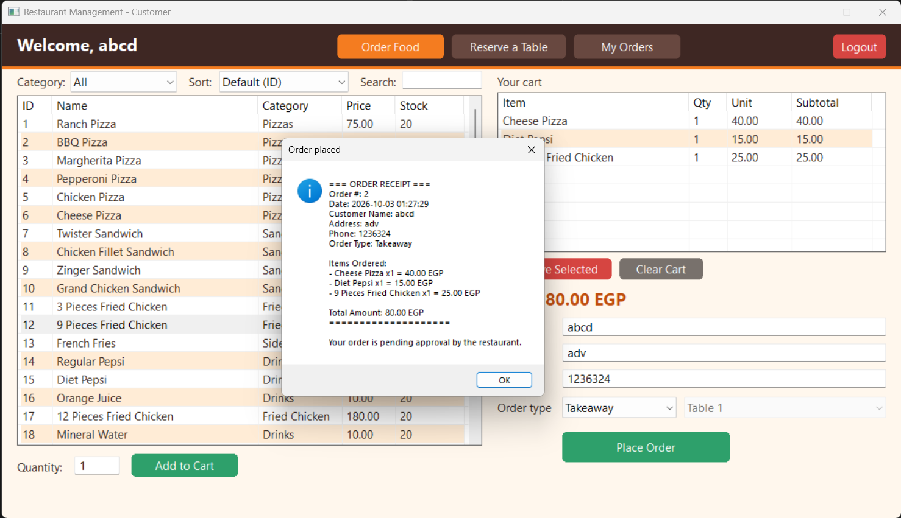
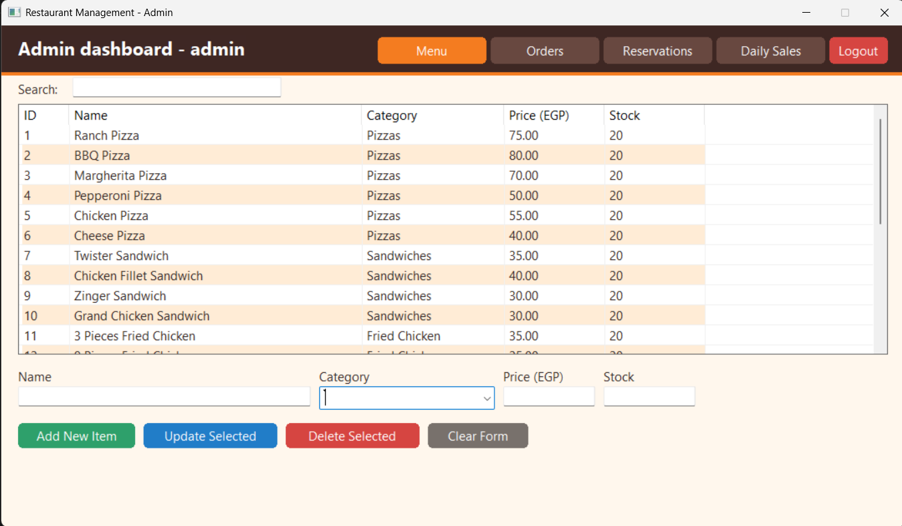
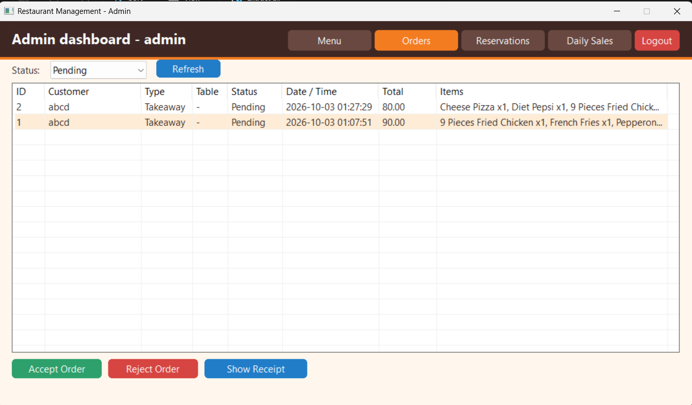
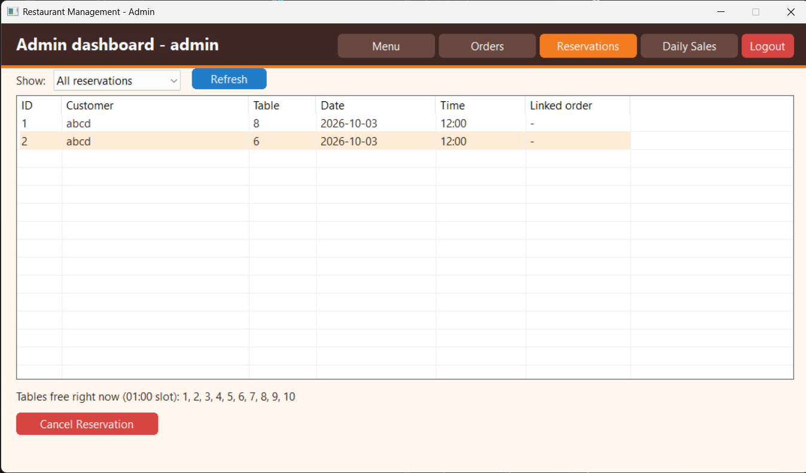
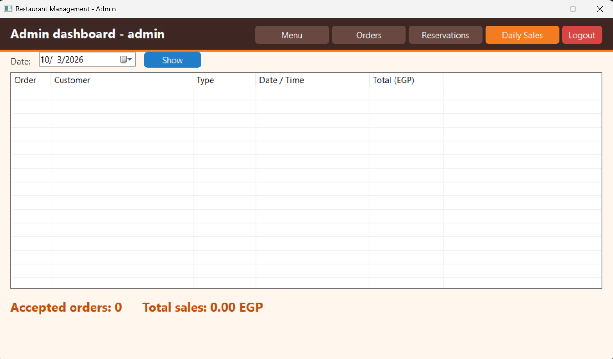

# Restaurant Management System (C++ / Win32 GUI)

A desktop restaurant management system written in **C++** with a native **Win32 API** graphical
interface (no external libraries) with a custom **colour theme** (warm cream background, dark top bar,
orange accents and colour-coded buttons). Customers can browse the menu, place orders, get a bill and
reserve tables; the admin manages the menu, processes orders, views reservations and checks the
daily sales. All data is stored in plain text files.

> **ECU - CSC-1200 Computer Programming II - Project 6**
> (Restaurant Management System Using C++ with GUI Interface)

## Features

### Customer
- Register / log in (passwords are salted + SHA-256 hashed)
- Browse the menu by **category**, **search** by name and **sort** by name or price
- Cart with live total, stock checks, remove / clear
- Checkout as **Takeaway** or **Dine-In** (pick a table; tables reserved right now are marked)
- Bill / **text receipt** generated for every order (`receipts/receipt_<id>.txt`)
- **Reserve a table** for a chosen date and hourly time slot, with live availability for that slot
- View and cancel own reservations; **order history** with receipts

### Admin
- Log in
- **Add / edit / delete** menu items (name, category, price, stock), with search
- View all orders, filter by status, **accept / reject** (stock is deducted on accept)
- View all table reservations (all / today / upcoming) and cancel them; free tables right now are shown
- **Daily sales report** for any date

### Interface
- Owner-drawn rounded buttons, colour-coded by action: green = confirm (Login, Add, Accept, Place, Reserve), red = destructive (Delete, Reject, Cancel, Logout, Exit), blue = neutral (Refresh, Show, Update), grey = Clear, orange = Register
- Top navigation bar; the open page is highlighted in orange
- Zebra-striped tables, orange headings, `Enter` triggers **Login** on the login screen

## Screens

| Screen | Purpose |
|---|---|
| Login | Sign in or register a customer account |
| Admin - Menu / Orders / Reservations / Daily Sales | Back-office tools |
| Customer - Order Food / Reserve a Table / My Orders | Ordering and reservations |

## Screenshots

### Login


### Customer
| Order Food | Reserve a Table |
|---|---|
|  |  |

| My Orders | Order Receipt |
|---|---|
|  |  |

### Admin
| Menu | Orders |
|---|---|
|  |  |

| Reservations | Daily Sales |
|---|---|
|  |  |

## OOP design

| Concept | Where |
|---|---|
| **Encapsulation** | `MenuItem`, `Order`, `Reservation`, `Database` keep data private behind getters/setters; file formats live inside `toLine()` / `fromLine()` |
| **Inheritance** | `Admin` and `Customer` derive from the abstract `User` (name, email, password hash); `LoginWindow`, `AdminWindow`, `CustomerWindow` derive from `AppWindow` |
| **Abstraction** | `User::role()` / `User::openMainWindow()` and `AppWindow` hooks (`onCreate`, `onCommand`, `onNotify`, ...) hide the Win32 plumbing (including theming and button drawing, which every window gets for free); `Database` hides file I/O |
| **Polymorphism** | `user->openMainWindow()` opens the admin or the customer window depending on the dynamic type; `role()` is overridden per class |

See [docs/ARCHITECTURE.md](docs/ARCHITECTURE.md) for the class diagram, window flow, order lifecycle and how the colour theme is drawn.

## Build

Requires Windows. Pick one toolchain.

**MinGW-w64 (g++)** with `g++` and `windres` on `PATH`:

```bat
build.bat
```

or manually:

```bat
windres resource.rc -O coff -o resource.o
g++ -std=c++17 -O2 -Wall -mwindows -static restaurant_management_gui.cpp resource.o -o RestaurantManagement.exe -lcomctl32 -lgdi32
```

**MSYS2 CLANG64 (clang++)**, same flags:

```bash
pacman -S --needed mingw-w64-clang-x86_64-clang mingw-w64-clang-x86_64-binutils
clang++ -std=c++17 -O2 -Wall -mwindows -static restaurant_management_gui.cpp resource.o -o RestaurantManagement.exe -lcomctl32 -lgdi32
```

**MSVC** (from *x64 Native Tools Command Prompt for VS*):

```bat
rc resource.rc
cl /std:c++17 /O2 /EHsc /utf-8 restaurant_management_gui.cpp resource.res /Fe:RestaurantManagement.exe /link /SUBSYSTEM:WINDOWS comctl32.lib gdi32.lib user32.lib shell32.lib
```

**Visual Studio IDE:** create an empty C++ project, add `restaurant_management_gui.cpp`, set
*Linker > System > SubSystem* to `Windows`, and add `comctl32.lib` to the linker inputs.

`resource.o` only embeds `app.manifest` (modern common-controls look for the date picker and list headers).
The colours come from the code itself, so you can leave the manifest out and the program still works.

> **Troubleshooting:** on managed machines (university / work PCs) an *Application Control* policy can block
> `g++.exe` / `cc1plus.exe` ("Permission denied" or "An Application Control policy has blocked this file").
> Try the clang++ or MSVC route above, or build on another machine. The `-static` executable needs no DLLs and
> can be copied anywhere.

## Run

Start `RestaurantManagement.exe`. Data files are created next to the executable on first run.

Default accounts (created when `users.txt` is missing):

| Role | Username | Password |
|---|---|---|
| Admin | `admin` | `admin123` |
| Customer | `user` | `user123` |

New customers can register from the login screen. To reset all accounts, delete `users.txt`.

## Data files

All files are comma-separated text and are created automatically.

| File | Format |
|---|---|
| `menu.txt` | `id,name,category,price,stock` |
| `users.txt` | `username,salt$sha256hash,role,email` |
| `orders.txt` | `id,customer,address,phone,type,table,status,timestamp,total,receiptPath,Item:qty;Item:qty,owner` |
| `reservations.txt` | `id,customer,table,date,time,orderId` (`orderId` is `0` for plain reservations) |
| `receipts/` | one text receipt per order |

Commas and semicolons typed into text fields are replaced with spaces so they cannot corrupt these files.

## How ordering works

1. A customer places an order; it is saved as **Pending**. A Dine-In order also reserves that table for the current hour slot.
2. The admin **accepts** (stock is checked and deducted) or **rejects** it (the dine-in table is released).
3. Only **Accepted** orders count toward the daily sales report.

## Project structure

```
restaurant_management_gui.cpp   all source code (model, storage, users, windows, WinMain)
docs/ARCHITECTURE.md            class diagram, window flow, order lifecycle (Mermaid)
resource.rc / app.manifest      optional: modern common-controls look
build.bat                       MinGW build script
legacy/                         earlier console version
```

## Colour theme

All colours live at the top of the UI section in `restaurant_management_gui.cpp`; change them to re-skin the app.

| Constant | Colour | Used for |
|---|---|---|
| `C_BG` | cream `#FFF7ED` | window background |
| `C_BAND` | dark brown `#3E2723` | top bar |
| `C_ACCENT` | orange `#F47C20` | active navigation page, accent line, Register |
| `C_HEAD` | burnt orange `#C04D0C` | headings |
| `C_TEXT` | dark brown `#342824` | body text, table text |
| `C_ROW_ALT` | peach `#FFECD6` | alternate table rows |

`buttonColor()` picks a button colour from its caption, so new buttons get a sensible colour automatically.

## Notes on the earlier console version

This GUI version keeps the same menu / order file layout, so existing `menu.txt` and `orders.txt`
files still load. It also fixes several problems of the console version:

- Stock was deducted twice (when adding to the cart and again when the admin accepted the order); it is now deducted once, on accept.
- Order numbers restarted at 1 on every run, producing duplicate IDs; IDs are now unique (old duplicates are repaired when loaded).
- Item names containing `:` (e.g. `Offer 1: ...`) broke order parsing when stock was updated.
- Default passwords were hardcoded and `users.txt` was overwritten on every start; accounts now persist and registration works.
- Rejecting a dine-in order did not release its table; the old `tables.txt` is replaced by `reservations.txt`, which supports dates and time slots.

## Limitations

- Single machine, file-based storage: no concurrent multi-user access.
- 10 tables and hourly slots from 12:00 to 23:00 (see `TABLE_COUNT` and `SLOTS` in the source).
- The theme is fixed (no dark mode switch) and buttons are drawn by the program rather than by Windows, so they ignore the system accent colour.
- Password hashing is salted SHA-256, which is fine for a course project but is not a replacement for a slow KDF such as bcrypt or Argon2 in production.
