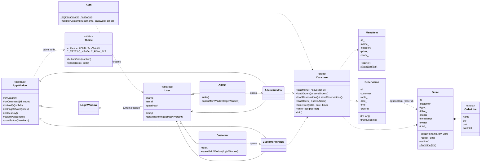
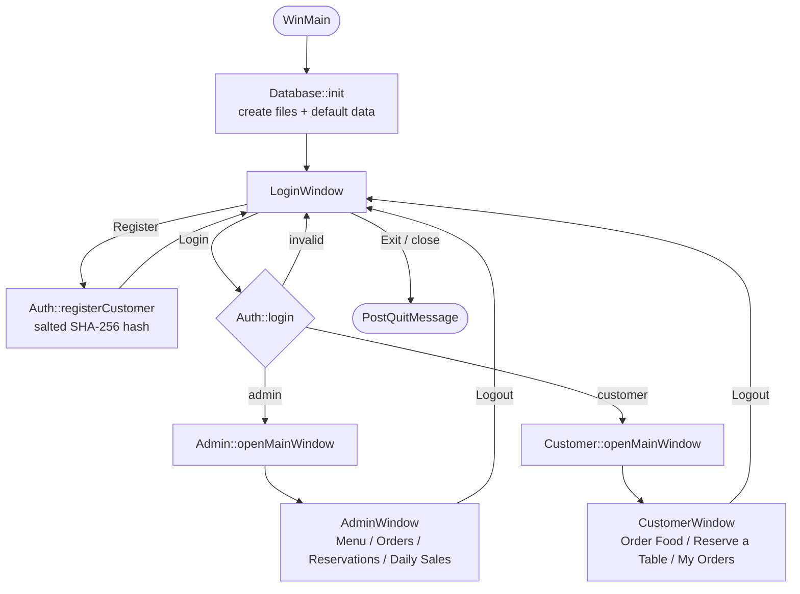
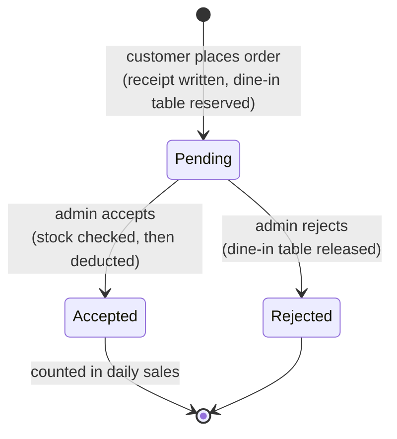
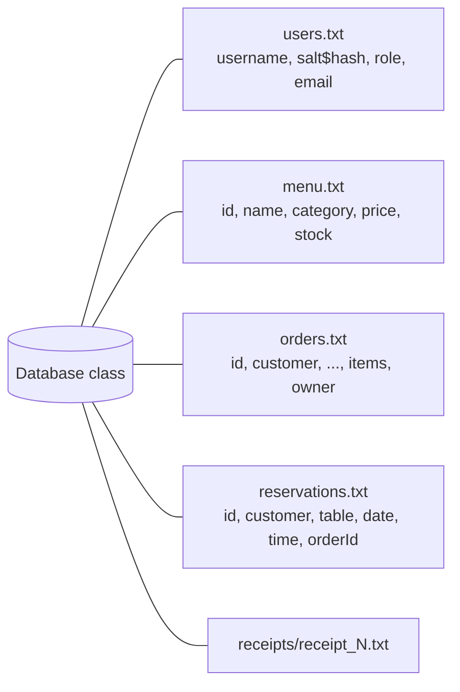
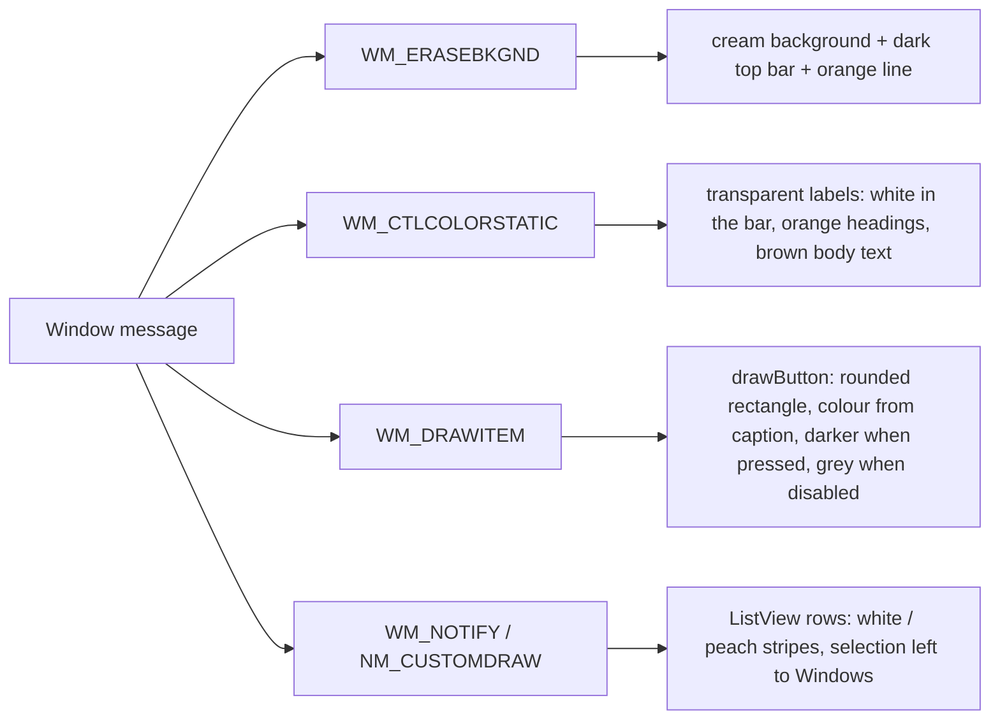

# Architecture

The program is a single translation unit (`restaurant_management_gui.cpp`) organised in layers:

```
Win32 windows (UI)  ->  Users / Auth  ->  Domain model  ->  Database (text files)
```

## 1. Class diagram



## 2. Window flow



Logging out destroys the role window, which posts `WM_APP_LOGOUT` to the (hidden) login window; the
login window then shows itself again and drops the session.

Because the buttons are owner-drawn, Windows can no longer see which one is the default button, so
`LoginWindow` answers `DM_GETDEFID` with the Login button; this keeps **Enter = Login** working.

## 3. Order lifecycle



## 4. Data storage



Every `save*` call rewrites the whole file and every `load*` call re-reads it, so each window always works
on fresh data and no state is cached between actions.

## 5. Design notes

- **Polymorphism drives navigation:** `LoginWindow` never checks the role. It calls
  `user->openMainWindow()` and the dynamic type (`Admin` or `Customer`) decides which window opens.
- **One window base class:** `AppWindow` owns the Win32 plumbing (window procedure, control factory,
  page switching). Derived windows only override hooks such as `onCreate` and `onCommand`.
- **Pages, not tabs:** each screen section is a group of child controls shown or hidden by `selectPage()`,
  driven by owner-drawn navigation buttons in the top bar; the open page's button is drawn in the accent colour.
- **Theme lives in the base class:** colours, button drawing and list striping are handled once in `AppWindow`
  (see section 6), so `LoginWindow`, `AdminWindow` and `CustomerWindow` are themed without extra code.

## 6. Colour theme and rendering

`AppWindow::handle()` intercepts a few standard messages to paint the interface:



- **Top bar:** the first `BAND_H` (60) pixels of every window. Labels whose rectangle lies inside it are drawn in white.
- **Buttons:** created with `BS_OWNERDRAW`. Navigation buttons use the accent colour when selected
  (`shown` page index) and a muted brown otherwise; other buttons call `buttonColor(caption)`
  (red / green / blue / grey / orange).
- **Tables:** `list()` sets white row colours and text colour; `NM_CUSTOMDRAW` alternates row backgrounds.
- **Re-skinning:** only the `C_*` constants and `buttonColor()` need to change.
- **Persistence is isolated:** only `Database` touches the files; models know their own line format
  (`toLine` / `fromLine`) but never open files.
